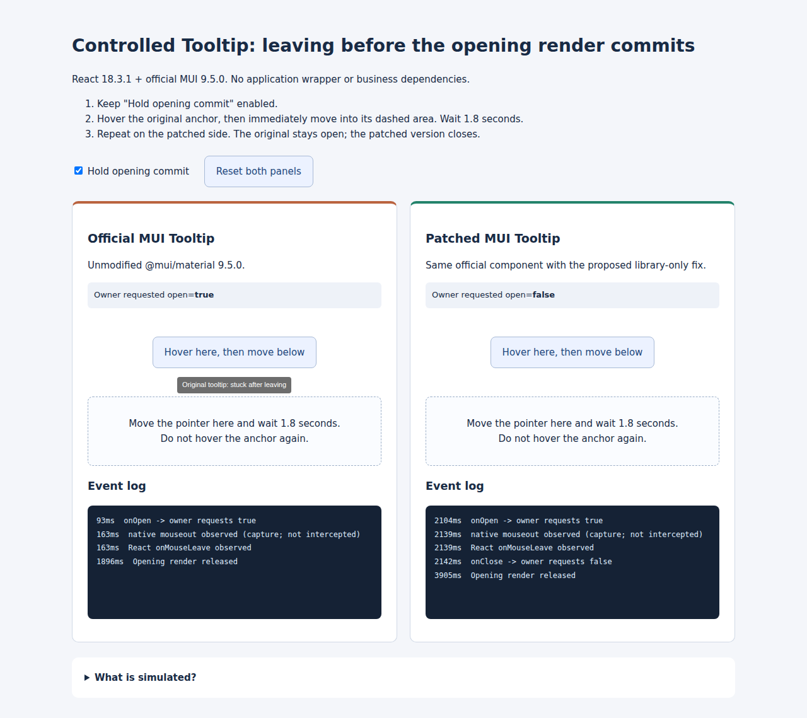

# Controlled MUI Tooltip: opening/closing race

A standalone English reproduction using official `@mui/material@9.5.0` and React `18.3.1`. There is no application wrapper and no forked component dependency.



## Download the standalone demo

Copy only this folder out of the monorepo before installing. For example:

```sh
npx degit 'cjz9032/material-ui/test/reproductions/tooltip-controlled-open#repro/tooltip-controlled-open-race' mui-tooltip-repro
cd mui-tooltip-repro
```

## Run

Requires Node.js 20.19+ (or another version supported by Vite).

```sh
npm install
npm run dev
```

Open http://127.0.0.1:5182.

## Reproduce

1. Keep **Hold opening commit** enabled.
2. Hover the **Official MUI Tooltip** button.
3. While the opening render is pending, move the pointer into the dashed area below it.
4. Wait 1.8 seconds without hovering the button again.
5. The original tooltip appears and remains open even though the pointer has left. Both `native mouseout` and `React onMouseLeave` are logged, but `onClose` is absent.
6. Repeat on **Patched MUI Tooltip**. `onClose` is logged and no tooltip remains.

Control experiments:

- Remain over either button: after release, the tooltip opens normally. There is one `onOpen`, no manufactured `mouseout`, and no open/close loop.
- Disable the simulation: both versions open and close normally.
- Use **Reset both panels** to repeat.

## Why this reproduces the race

The controlled owner requests opening with `startTransition(() => setOpen(true))`. A test anchor suspends only that opening render. The previously committed anchor remains visible and hit-testable: the fallback does not hide it.

If the pointer leaves before the opening render commits, Tooltip's close handler still sees the last committed `open=false`. Its `if (onClose && open)` guard suppresses the close notification. The owner therefore never requests `false`, and the outstanding opening update can commit later.

This deliberately holds an uncommitted-render window. It does not simulate an entire application's workload, busy-wait on the main thread, suppress mouse events, or dispatch synthetic mouse events. `describeChild` is only used by the harness to identify the opening render.

## Proposed fix

Synchronously track a pending opening request. Notify the owner on close if either the committed state is open or there is an outstanding opening request. Clear the request before the callback and after opening commits; repeated mouseover while already open must not create a pending request.

`prepare-fixed-tooltip.mjs` creates `Tooltip.repro-fixed.mjs` next to the installed upstream module so its relative dependencies remain unchanged. It never overwrites the official `Tooltip.mjs`; the left panel always uses the original module. The right panel differs only by the proposed library bookkeeping and close guard. The script fails if its exact source anchors no longer match.

## Browser tests

```sh
npx playwright install chromium
npm test
```

An existing Chromium executable may be selected with `PLAYWRIGHT_EXECUTABLE_PATH=/path/to/chrome npm test`.

The tests use actual Playwright mouse movement and verify the original/fixed result, normal hover, and stationary-hover controls. A side-by-side screenshot is saved under `test-results/`.

```sh
npm run build
```

## Relation to the pull request

The reproduction is separate from the library change so the pull request itself can remain limited to `packages/mui-material/src/Tooltip/Tooltip.js`. This reproduction pins an official release; the proposed source change is based on the latest upstream default branch.
